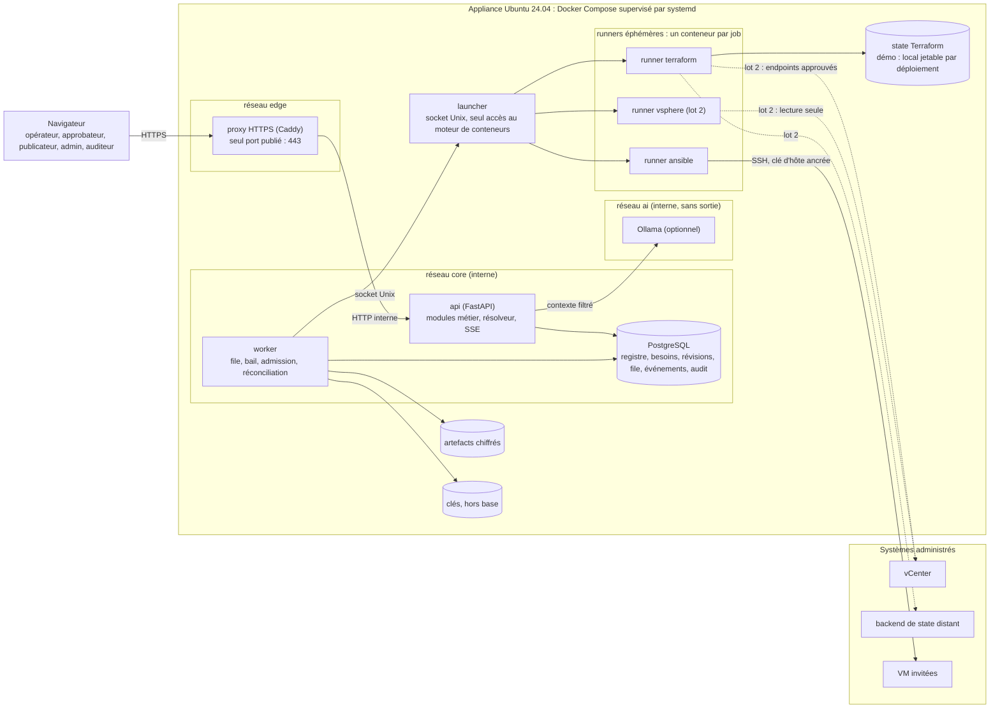
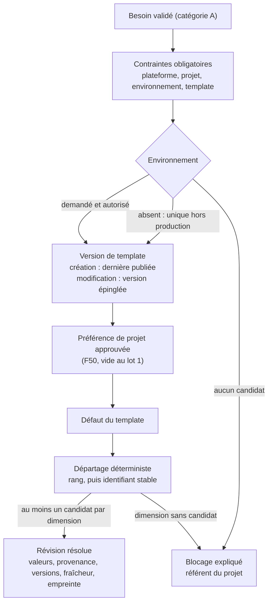
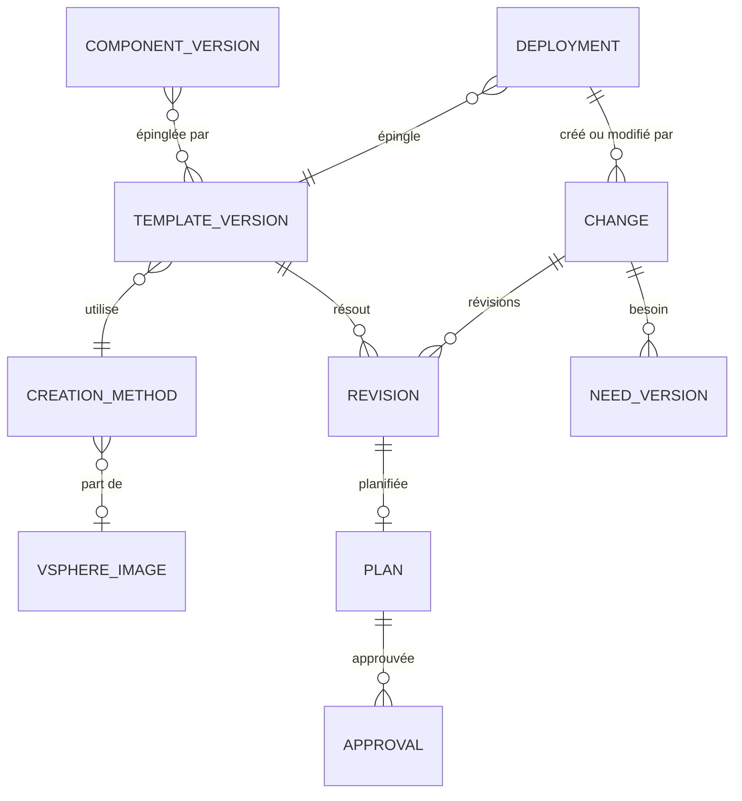
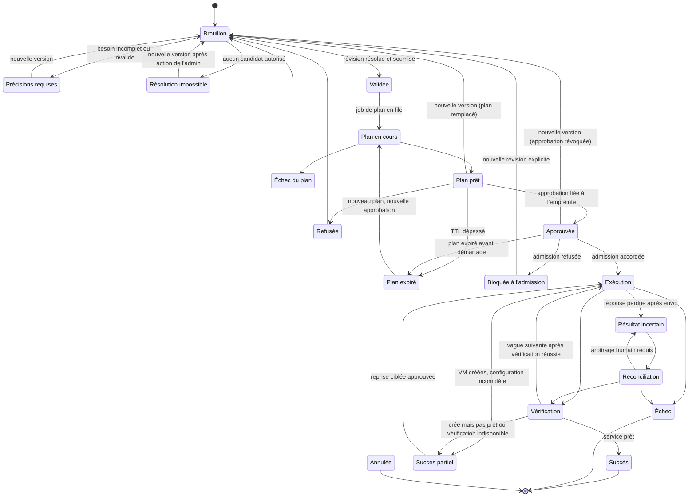
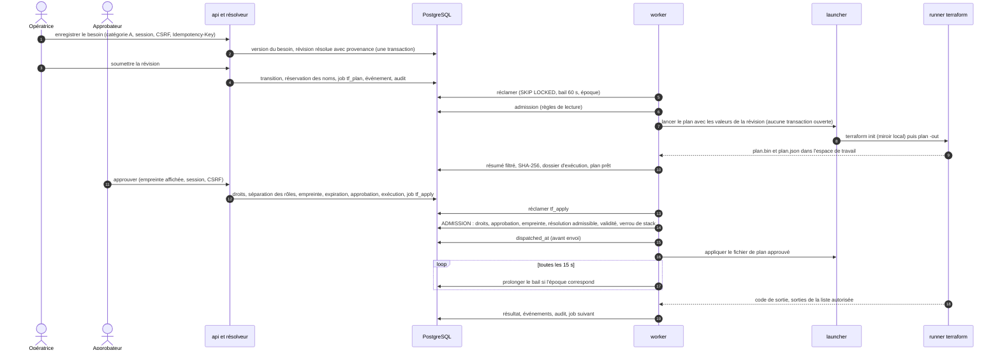

# Architecture de Rackloom

Statut : lot 0 (cadrage). Rien n'est implémenté ; ce document décrit la cible v1 et ce que le lot 1 en réalise. Les décisions structurantes sont justifiées dans `docs/adr/`.

## 1. Principes

- **L'utilisateur choisit le besoin, Rackloom choisit la technique.** Un seul schéma de besoin et un seul résolveur côté serveur servent la WebUI, le chat, l'API, la CI, les imports, les duplications et les reprises (ADR-0008).
- **Les profils de service sont des versions publiées et immuables de templates Rackloom**, bâties sur un registre de composants versionnés. Une image vSphere n'est qu'un point de départ (ADR-0009).
- **Monolithe modulaire** pour le plan de contrôle (un code Python, deux points d'entrée : `api` et `worker`), **processus d'exécution séparés** (`launcher` et runners éphémères). Pas de Kubernetes en v1.
- **Orchestrer, ne pas réimplémenter** : vCenter observe, Terraform possède les ressources de son state, Ansible configure l'OS. Rackloom décide *qui peut demander quoi*, *ce qui a été approuvé* et *ce qui s'est réellement passé*.
- **Le serveur est la seule autorité** : droits, validation, résolution, approbation et admission sont vérifiés côté serveur, au plus près de l'action.
- **PostgreSQL d'abord** : métadonnées, besoins et révisions, registre, file durable, événements et audit dans une seule base. Pas de courtier de messages en v1.
- **Une seule porte d'exécution** : le point d'admission (§11) est évalué au démarrage effectif de chaque job.

## 2. Vue d'ensemble

| Service | Rôle | Réseaux | Privilèges | Publié |
|---|---|---|---|---|
| `proxy` | TLS, en-têtes de sécurité, fichiers statiques de la WebUI, relais `/api` | edge | aucun | 443 (dev : `127.0.0.1:8443`) |
| `api` | HTTP, sessions, autorisation, validation du besoin, résolveur, publication des templates, approbations, SSE, chat | edge, core, ai | rôle PostgreSQL `rackloom_api` ; clé publique de la boîte à secrets ; clé « rapports » | non |
| `worker` | réclamation des jobs, admission, préparation des espaces de travail, déchiffrement des secrets du job, filtrage des sorties, réconciliation | core | rôle `rackloom_worker` ; clé privée de la boîte à secrets ; clés d'artefacts | non |
| `launcher` | crée, signale et inspecte les conteneurs runners selon une spécification validée | aucun réseau, socket Unix partagé avec le worker | seul service ayant le socket du moteur de conteneurs (cible : Podman sans root) | non |
| runners | exécutent Terraform CLI ou Ansible Runner pour un job | réseau propre au type de job | utilisateur non root, aucune capacité, rootfs en lecture seule | non |
| `postgres` | base unique | core | — | non |
| `ollama` | modèle local optionnel | ai (sans sortie) | — | non |

La WebUI (Nuxt, Vue, TypeScript) est générée en mode SPA (`ssr: false`) et servie en fichiers statiques par le proxy : pas de serveur Node en production, API de même origine sous `/api/v1`, client typé généré depuis `openapi/openapi.json`. Les formulaires de besoin et les vues de contrats sont produits par un moteur de rendu unique à partir des contrats du registre : il n'y a pas d'écran par logiciel.

## 3. Modules du monolithe et règles de dépendance

`identity`, `projects` (projets, environnements, politiques d'environnement, octrois), `registry` (composants, templates, publication), `studio` (brouillons de l'atelier, AT01), `resolver`, `connectors`, `inventory`, `changes` (besoins, révisions, transitions), `deployments`, `approvals`, `executions`, `admission`, `policy`, `hosts`, `events`, `audit`, `chat`, `secrets`, `artifacts`, `telemetry`, plus `api` (routes) et `worker` (boucle d'exécution).

Règles vérifiées par `import-linter` dans `make test` :

- `resolver` est le **seul** module qui produit des valeurs techniques de déploiement. C'est une fonction pure sur des lectures (registre, politiques, octrois, instantané d'inventaire) ; il n'importe ni `connectors`, ni `executions`, ni `secrets`.
- `changes` accepte uniquement des besoins de catégorie A et obtient les valeurs techniques du `resolver` ; `executions` ne lit que les révisions enregistrées.
- `chat` ne peut importer ni `inventory`, ni `resolver`, ni `secrets`, ni `executions`, ni `approvals`, ni `connectors`. Il lit les services déployables et les événements via des fonctions déjà filtrées par périmètre, et produit un *brouillon de besoin* revalidé par `changes`.
- `registry` publie des versions ; il n'importe ni `executions` ni `approvals` : publier ne crée aucun job.
- `studio` (atelier) ne produit aucune valeur technique de déploiement et n'importe ni `inventory`, ni `secrets`, ni `executions`, ni `approvals`, ni `connectors`, ni `worker`, ni `resolver`. Une suggestion acceptée est réappliquée comme une saisie, sur les seuls chemins de conception.
- Le déchiffrement des secrets (`secrets.unseal`) et des plans n'est importable que depuis `worker`.
- Toute écriture d'état d'un changement passe par `changes.transitions`, qui écrit l'événement et l'audit dans la même transaction.
- Toute lecture de données projet passe par un dépôt « scopé » qui exige un `Principal` et filtre par projets autorisés.
- Les actions proposées à l'UI viennent d'une seule fonction `workflow.available_actions(principal, resource, now)`, calculée depuis l'état et les droits courants. Chaque route d'action réévalue cette fonction à l'appel ; l'UI ne déduit jamais un droit.

## 4. Frontières de confiance

| ID | Frontière | Ce qui traverse | Contrôles |
|---|---|---|---|
| TB1 | Navigateur → proxy | requêtes utilisateur (non fiables) | TLS, HSTS, CSP stricte, `frame-ancestors 'none'`, limites de taille |
| TB2 | proxy → api | requêtes authentifiées, besoins | session serveur, CSRF sur écritures, autorisation par ressource, clé d'idempotence, **rejet de tout champ technique**, limitation de débit |
| TB3 | api ↔ modèle | contexte filtré vers le modèle ; sorties du modèle (non fiables) | services et besoin seulement, aucun inventaire technique, schéma strict, revalidation serveur, aucune capacité d'action |
| TB4 | api, worker → PostgreSQL | toutes les données | rôles distincts, audit en ajout seul, versions de besoin, révisions et versions publiées immuables (triggers) |
| TB5 | worker → launcher | spécification de run | liste blanche d'images par empreinte, profils de limites et de réseau par type de job, aucun montage arbitraire |
| TB6 | runner → worker | sorties d'outils (non fiables) | événements structurés bornés, filtrage des secrets, sorties brutes chiffrées, jamais dans les événements |
| TB7 | runner → systèmes administrés | appels vCenter, backend de state, SSH | endpoints approuvés par l'admin, CA importée, ancre de clé d'hôte, identifiants propres au job |
| TB8 | invités → Rackloom | faits, paquets, journaux, noms | données non fiables, bornées, filtrées, échappées, jamais exécutées ni obéies |
| TB9 | clés ↔ données | chiffrés en base et sur disque | clés hors base, montées en lecture seule et seulement là où nécessaire, sauvegardées séparément |
| TB10 | dépôt `catalog/` → registre | contrats de composants et de templates | revue Git, chargeur qui valide les contrats, refuse les secrets littéraux et toute modification d'une version publiée ; publication par un rôle distinct |

## 5. Propriétaires des données

| Donnée | Source de vérité | Stockage | Écrit par | Lu par |
|---|---|---|---|---|
| Comptes, sessions, rôles | Rackloom `identity` (lot 4 : identité portée par l'IdP OIDC, rôles par Rackloom) | PostgreSQL | api | api |
| Projets, environnements, politiques d'environnement, octrois | Rackloom `projects` (catégorie C) | PostgreSQL, politiques versionnées | api (admin) | api, resolver, worker |
| Composants et templates | sources revues dans `catalog/` (Git) ; **versions publiées immuables** dans le registre | PostgreSQL (contrat, empreinte, statut, historique) | chargeur ; publication par `template_publisher` | resolver, api, worker |
| Images vSphere | **vCenter** (inventaire) ; leurs attributs (OS, layout) sont déclarés à la construction de l'image | instantanés d'inventaire | worker | resolver |
| Besoins (catégorie A) et provenance | Rackloom `changes` | PostgreSQL (versions immuables) | api | api, chat (filtré) |
| Révisions (valeurs résolues, provenance, versions, fraîcheur) | Rackloom `resolver` / `changes` | PostgreSQL (immuables) | api | api, worker |
| Déploiements (version de template épinglée, stack) | Rackloom `deployments` | PostgreSQL | worker | api |
| Plans Terraform binaires | Rackloom `artifacts` | fichiers chiffrés (clé A) ; SHA-256 en base | worker | worker uniquement |
| Résumé de plan filtré, dossier d'exécution | Rackloom `executions` | PostgreSQL | worker | api |
| State Terraform | **backend Terraform** (démo : local jetable par déploiement ; réel : distant chiffré et verrouillé) | hors base applicative | runner terraform | runner terraform ; la base ne garde que `lineage` et `serial` |
| Inventaire et état observé des VM | **vCenter** (lot 1 : vCenter fictif) | PostgreSQL (instantanés horodatés) | worker | api, resolver |
| État de l'OS, paquets, services | **l'hôte** | PostgreSQL (observations horodatées et filtrées) | worker | api, chat (filtré) |
| Valeurs de secrets | coffre externe ou boîte scellée locale ; templates et composants ne contiennent que des références | chiffrés (clé privée hors base) | api (scelle, ne peut pas lire) | worker (pour le job seulement) |
| Événements | Rackloom `events` | PostgreSQL | api, worker | api (SSE) |
| Audit | Rackloom `audit` | PostgreSQL en ajout seul, chaîné par hachage | api, worker | auditeur, admin |
| Conversations | Rackloom `chat` (non autoritatif) | PostgreSQL, rétention bornée | api | api |
| Rapports et journaux filtrés | Rackloom `artifacts` | fichiers chiffrés (clé B) | worker | api (téléchargement autorisé) |

## 6. Flux réseau

| ID | Source | Destination | Port | Objet | Lot | Contrôle |
|---|---|---|---|---|---|---|
| N1 | réseau d'administration | proxy | 443/tcp | WebUI, API, SSE | 1 | TLS ; dev : écoute sur `127.0.0.1:8443` |
| N2 | proxy | api | 8000/tcp (edge) | relais HTTP | 1 | réseau Compose interne |
| N3 | api, worker | postgres | 5432/tcp (core) | données | 1 | `core` est `internal: true` |
| N4 | api | ollama local ou endpoint privé approuvé | 11434/tcp ou 443/tcp | inférence | 1 (optionnel) | liste d'endpoints approuvés ; aucun repli cloud |
| N5 | worker | launcher | socket Unix | lancement des runners | 1 | volume dédié, permissions 0660 |
| N6 | runner terraform (démo) | aucune | — | providers depuis miroir local | 1 | réseau `none` |
| N7 | runner ansible / vérification | nœuds de labo | 22/tcp, 80/tcp | configuration, collecte, sonde | 1 | réseau `rn-lab` interne |
| N8 | runner terraform | vCenter, backend de state | 443/tcp | création des VM | 2 | endpoints approuvés, filtrage sortant sur l'hôte (nftables) |
| N9 | runner vsphere | vCenter | 443/tcp | inventaire, suivi | 2 | identité d'inventaire en lecture seule |
| N10 | runner ansible | VM gérées | 22/tcp | configuration et collecte | 2 | réseaux de gestion autorisés, ancre de clé d'hôte |
| N11 | appliance | NTP, DNS internes | 123/udp, 53 | exploitation | 3 | configurés au premier boot |

Aucun flux entrant vers PostgreSQL, Ollama, le launcher ou les runners. Les invités n'initient aucune connexion vers l'appliance en v1 (la passerelle de télémétrie F23 est une extension).

## 7. Besoin, résolution et templates

### 7.1 Trois catégories de données

| Catégorie | Qui la modifie | Où | Contenu |
|---|---|---|---|
| A. Besoin | le demandeur | parcours « Déployer » (WebUI, chat, API, CI) | projet si plusieurs, service, environnement seulement s'il existe un choix ou une demande explicite de production, entrées fonctionnelles déclarées par le template (quantité, niveau, usage, date de fin) |
| B. Résolu et verrouillé | le résolveur, jamais le demandeur | panneau « Détails du plan », lecture seule | image, placement (cluster, resource pool, dossier, datastore), réseau et VLAN, IP et DNS, nom, vCPU, RAM, disque, versions de composants, rôles et module, runner, backend de state, identités techniques, sauvegarde, quotas, politiques de sécurité, circuit d'approbation |
| C. Administration | rôles habilités, hors parcours | section « Administration » | templates et composants (publication), politiques d'environnement, octrois, connecteurs ; l'atelier de conception (AT01) y ajoutera les brouillons |

Il n'existe pas de mode expert : aucun rôle ne peut injecter une valeur de catégorie B dans un besoin. Les auteurs habilités définissent les paramètres techniques dans un template, puis un publicateur publie une nouvelle version.

### 7.2 Résolveur central

- Mêmes entrées et même instantané donnent la même révision et la même empreinte.
- La production n'est jamais choisie par défaut, et il n'y a jamais de repli vers un autre environnement, réseau ou compte.
- Une question n'est posée à l'utilisateur que si la différence change le résultat visible (site, délai, disponibilité, budget).
- Les motifs de blocage ne nomment aucune ressource hors du périmètre de l'utilisateur.
- L'approbation est liée à la révision. À l'admission, la règle 55 vérifie que la résolution reste admissible ; elle ne recalcule jamais.

### 7.3 Templates, composants et images

- **Composant versionné** : OS et prérequis pris en charge, contrat de paramètres (types, valeurs, défauts, conditions, références de secrets), dépendances et incompatibilités, effets attendus (paquets, fichiers, services, ports, redémarrage), contrôles après installation, implémentation (rôle Ansible épinglé). Les formulaires et vues sont générés depuis ces contrats.
- **Version de template** : méthode de création (clonage d'image vSphere ou installation Ubuntu automatisée), profil système (OS, volumes et partitionnement, réseau, règles de sécurité), composants épinglés avec configuration déclarative, contrat d'entrées fonctionnelles (catégorie A), paramètres par environnement, références de secrets, contrôles de santé, politique de déploiement (cibles admissibles, approbation, vagues, conditions d'arrêt, reprise), liste des sorties publiables.
- **Image vSphere** : point de départ inventorié, avec attributs déclarés à sa construction (OS, `layout_id`). Le partitionnement exact vient de l'image ou d'une installation automatisée, jamais d'un rôle Ansible appliqué après coup.
- **Cycle de vie** : `validated` → `published` → `deprecated`, avec `withdrawn` pour un retrait. L'atelier ajoute `in_review` (soumis, immuable, empreinte affichée) et `returned` (renvoyé à l'auteur, qui produit une nouvelle version). `draft` et `lab_tested` restent des statuts réservés. Toute modification produit une nouvelle version ; passer un déploiement à une nouvelle version est un changement distinct.
- **Atelier (AT01)** : un auteur part d'une version publiée. Il ne décrit que le besoin de conception (titre, description, composants du catalogue et leurs paramètres déclarés, mode de vagues). Placement, réseau, taille, module Terraform, secrets et commandes sont refusés. L'assistant propose ; chaque suggestion est acceptée une par une et revalidée. Une demande hors catalogue devient une proposition d'extension, jamais une exécution. Soumettre crée une version `in_review`. Publier est un autre geste, par le publicateur, sur l'empreinte affichée, et ne crée aucun job.
- **Vagues** : `deployment_policy.waves` vaut `single` (une seule vague, seul mode du lot 1 pour `ubuntu-web`) ou `pilot` (pilote de 1 à 3 machines, puis vagues de 1 à 10, arrêt obligatoire si une vague échoue). Le plan fige la liste. Une machine rattachée après l'approbation est `out_of_scope` et n'est pas configurée. L'échec du pilote laisse la vague suivante `wave_blocked`.
- **Droits** : déployer (`operator`), approuver (`approver`), concevoir (`template_author`) et publier (`template_publisher`) sont distincts. Publier ne déploie rien, et approuver un déploiement ne permet pas de modifier un template. Pour une version `in_review`, l'auteur qui l'a soumise ne peut ni la publier ni la renvoyer.

## 8. Cycle d'un changement

Un **changement** porte un besoin, ses versions immuables, les révisions résolues, les plans, les approbations, l'exécution et les jobs. Il crée un **déploiement** (stack Terraform dédiée, version de template épinglée) ou le modifie. Son identifiant (`change_id`, UUIDv7) est l'**identifiant de corrélation** porté par tous ses événements, jobs, décisions d'admission, entrées d'audit, étiquettes de runners et lignes de journal applicatif.

L'annulation est possible depuis tout état antérieur à `executing` (→ `cancelled`). Pendant `executing`, elle devient une **demande** (`cancel_requested_at`) : le résultat final reflète ce que le fournisseur a réellement fait.

**Résultat d'un déploiement : succès du job et état du service sont séparés.** Un job réussi dit seulement que l'outil a terminé. L'état du service (`deployments.service_status`) est calculé par le serveur à partir de l'état observé des ressources et des contrôles de santé de la version de template, avec la preuve et l'heure de chaque contrôle :

| État du service | Condition | Changement |
|---|---|---|
| prêt (`ready`) | tous les contrôles de santé ont réussi lors de la dernière vérification | Succès |
| créé mais pas prêt (`created_not_ready`) | ressources présentes, configuration incomplète ou au moins un contrôle en échec | Succès partiel, avec le contrôle en cause |
| échec (`failed`) | ressources attendues absentes | Échec |
| vérification indisponible (`verification_unavailable`) | contrôles non exécutables (hôte injoignable, délai) | Succès partiel, « vérification indisponible » |

Aucun résumé du modèle n'alimente cet état. La fiche « Votre service est prêt » (F57) et ses actions (F58) le lisent sans le recalculer.

## 9. Garanties d'exécution

- **File PostgreSQL** (ADR-0005) : réclamation par `FOR UPDATE SKIP LOCKED` en transaction courte ; bail de 60 s prolongé toutes les 15 s ; `lease_epoch` incrémenté à chaque réclamation et exigé dans toute écriture du worker (jeton de clôture) ; une faucheuse traite les baux expirés.
- **Avant/après envoi** : un job d'écriture dont `dispatched_at` est nul peut être remis en file et réadmis. Une fois `dispatched_at` posé, une perte de bail fait passer le job en `uncertain`, jamais en relance automatique.
- **Réconciliation** : job en lecture seule qui interroge le launcher (le runner existe-t-il, avec quel code de sortie ?) puis le state (`lineage`, `serial`, ressources attendues par le plan). Conclusions possibles : appliqué, non appliqué (state inchangé et aucun runner actif), ou indéterminé (arbitrage humain). Une relance d'écriture est toujours une action humaine autorisée.
- **Idempotence HTTP** : en-tête `Idempotency-Key` obligatoire sur les écritures ; même clé et même corps → même réponse ; même clé et corps différent → 422.
- **Verrous** : un seul job d'écriture admis par stack (`stacks.lock_job_id`, mise à jour conditionnelle) en plus du verrou du backend Terraform.
- **Délai vs non-exécution** : l'UI distingue « la requête a expiré, état réel en cours de vérification » de « l'opération n'a pas eu lieu », qui n'est affiché qu'après preuve.
- **Pas d'exactement-une-fois** : au plus un envoi par décision d'admission et une réconciliation avant toute relance ; pas d'exécution unique garantie de bout en bout.

## 10. Dossier d'exécution et empreinte

Le **dossier d'exécution** est un JSON canonique (RFC 8785) produit avec le plan ; son SHA-256 est l'**empreinte** affichée à l'approbateur et enregistrée dans l'approbation. Il contient :

- `change_id`, numéro et SHA-256 de la version du besoin, numéro et `resolution_digest` de la révision, projet, environnement, version de la politique d'environnement ;
- template (slug, version, empreinte) et empreinte de chaque composant et rôle épinglé ;
- cibles : déploiement, stack, connecteurs et version de leur configuration ;
- module Terraform (version, empreinte, SHA-256 du lockfile), version de la CLI, empreinte de l'image runner, SHA-256 du plan binaire, `lineage` et `serial` du state au moment du plan ;
- playbook, SHA-256 des variables générées, empreinte de l'image runner Ansible ;
- contrôles de santé ;
- version et empreinte du bundle de politiques ;
- `valid_until` du plan.

L'admission recalcule l'empreinte depuis l'état courant ; toute différence bloque le job et exige une nouvelle approbation. Une nouvelle version de template ne change pas l'empreinte d'un plan approuvé sur l'ancienne. En revanche, une mise à jour de l'appliance qui change une image runner invalide les approbations en attente.

## 11. Point d'admission unique

`admission.check(job, now)` est appelé par le worker **après réclamation et avant tout envoi**, pour chaque job, sans exception. Il évalue un registre ordonné de règles et enregistre une décision (`admission_decisions` : règles évaluées, version, résultat, code motif, champ concerné, version du bundle de politiques). Un refus passe le job en `blocked` avec un motif lisible ; aucune écriture n'est envoyée.

Chaque type de job déclare une classe `read` ou `write`. Les règles d'écriture ne s'appliquent qu'à la classe `write` : un gel, une fenêtre ou un disjoncteur n'empêche jamais l'inventaire, la collecte ou le diagnostic.

| Ordre | Règle | Classe | Lot |
|---|---|---|---|
| 10 | profil : connecteur simulé refusé en production | toutes | 1 |
| 20 | droits courants du demandeur | toutes | 1 |
| 30 | droits courants de l'approbateur et séparation des rôles | write | 1 |
| 40 | approbation valide, non révoquée, exécution non déjà démarrée | write | 1 |
| 50 | empreinte du dossier recalculée identique | write | 1 |
| 55 | résolution toujours admissible : version de template non retirée, valeurs résolues encore octroyées | write | 1 |
| 60 | plan non expiré (marge 60 s), sans suppression ni remplacement | write | 1 |
| 65 | configuration limitée aux cibles de la liste approuvée (reprise : intersection avec le périmètre approuvé) | write (`ansible_configure`) | AT01 |
| 70 | annulation non demandée | toutes | 1 |
| 80 | gel d'environnement (démarrage et envoi au fournisseur) | write | F28 (`builtin@2`) |
| 90 | fenêtre ou période de gel du calendrier | write | F27 (`builtin@3`) |
| 95 | disjoncteur du connecteur fermé | write | F37 (`builtin@4`) |
| 110 | capacité sur le placement | write | F05 (`builtin@5`) |
| 100 | droits temporaires encore valides | write | F11 (`builtin@8`) |
| 110 | capacité sur le placement | write | F05 (`builtin@5`) |
| 115 | sauvegarde vérifiée pour un changement sensible | write | F39 (`builtin@9`) |
| 120 | réservations IPAM/DNS confirmées | write | F03 (`builtin@6`) |
| 125 | licences disponibles | write | F34 (`builtin@7`) |
| 130 | zone du runner autorisée pour l'environnement | toutes | F16 (`builtin@10`) |
| 135 | combinaison de versions compatible | write | F38 (`builtin@9`) |
| 140 | politiques versionnées de l'organisation | write | F10 (`builtin@8`) |
| 900 | verrou de stack acquis | write | 1 |

## 12. Points d'extension réservés pour le backlog

Ils sont présents au lot 1 parce qu'ils coûtent peu et évitent une migration douloureuse. Aucune fonction du backlog n'est implémentée.

| Point | Présent au lot 1 | Servira à |
|---|---|---|
| Registre d'admission ordonné, classes `read`/`write`, décisions enregistrées (étape `start` et, pour les règles sensibles au temps, `dispatch`) | oui (`builtin@10` : R010–R140, R900, dont R130 F16) | F27, F37, F34, F11, F05, F39, F03, F16, F38, F10, F36 |
| Étape « préférence de projet » dans l'ordre de résolution | oui (`project_preference_versions`, provenance `project_preference`) | F50 |
| Départage du résolveur isolé dans une fonction remplaçable | oui (rang, puis identifiant) | F32 |
| Source `ci` acceptée par le même schéma et le même résolveur | oui (client simulé) | F35 |
| `outputs_allowlist` dans le contrat de template | publiée via `deployment_outputs` + `GET …/outputs` | F33 |
| Statuts `draft`, `lab_tested`, rôle `template_author`, `deployment_policy.waves` | `in_review`, `returned`, rôle auteur et vagues `single` ou `pilot` livrés (AT01) ; `draft` et `lab_tested` restent réservés | F19 (trois nœuds, fenêtres, redémarrage) |
| `verification_level` des composants calculé depuis les preuves | oui | AT01, F38 |
| Versions réellement utilisées enregistrées dans le dossier d'exécution | oui | F38 |
| Insertion d'un job avant `tf_plan` dans la chaîne | oui (`preflight`, classe `read`, F31) | F31 |
| Compteurs d'erreurs par connecteur et par capacité | oui | F37 |
| `correlation_id` sur événements, jobs, audit, runners et logs ; `events.source` ; `dedupe_key` unique ; reprise SSE | oui | F21, F22, F25, F44 |
| `policy_bundles` versionnés et politiques d'environnement versionnées dans chaque révision et dossier | oui | F10, F24 |
| `jobs.run_after` et revalidation complète à l'admission | oui | F27, F36 |
| Contexte d'authentification de l'approbateur | oui | F12 |
| Fraîcheur des instantanés d'inventaire dans chaque révision | oui | F05, F09, F32 |
| Champ `zone` dans la spécification du launcher | oui (slugs `dev`/`prod`/… ; défaut `local`) | F16 |
| Secrets en écriture seule côté API, références dans les contrats | oui | F13, F43 |
| Contrat de connecteur à capacités et suite de contrat | oui (connecteurs du lot 1) | F30 |
| Adaptateurs de modèle interchangeables, constructeur de contexte filtré, scénarios fictifs rejouables, banc d'évaluation (`chat_eval_reports`, prompt `rackloom.chat-prompt/v1`), routage des modèles, aperçu de contexte, runbooks | oui | F46, F47, F48, F49 |
| Date de fin capturée | appliquée : bail (`deployment_leases`), rappels, renouvellement, plan de retrait (exécution locale simulée) | F06 |
| Interrupteur global de suspension des envois (`dispatch_paused`) | non | F26, maintenance |
| État du service distinct de l'état des jobs, preuves et heure par contrôle de santé (§8) | oui | F57, F58 |
| Actions disponibles calculées côté serveur (`allowed_actions`) et revérifiées à l'appel | oui | F55, F58, F51 |
| Collecte en lecture seule par playbook approuvé, identité sans élévation, observations filtrées par type | oui | F60, F24 |
| Correspondance approuvée entre niveau d'accès et groupe d'identité | oui (faux IdP local ; IdP réel : lot 4) | F59 |

### 12.1 Règles posées pour les fonctions utilisateur F51 à F60

Ces règles s'appliquent dès qu'une fonction les touche ; le lot 1 n'en livre que les bases marquées « oui » ci-dessus.

**a. Résultat d'un déploiement (F57).** La fiche service affiche l'état du service défini au §8 (prêt, créé mais pas prêt, échec, vérification indisponible), avec la preuve et l'heure de chaque contrôle de santé du template. Le succès d'un job ne vaut jamais « prêt ». Les URL et noms affichés proviennent de la liste des sorties autorisées du template (`outputs_allowlist`, puis F33) ; aucun identifiant, aucune URL contenant un secret et aucune donnée hors périmètre n'y figure.

**b. Actions disponibles (F55, F58).** Les entrées « À moi d'agir », « En attente d'une autre personne » et les boutons de la fiche service sont calculés par `workflow.available_actions` à partir de l'état du workflow, du template, de l'état du service et des droits courants, puis revérifiés au clic par la route appelée. Une action terminée, devenue impossible ou retirée par une révocation n'apparaît plus comme actionnable. Un bouton de la fiche service ouvre un changement prérempli qui repasse par le résolveur, le plan, l'approbation et l'admission, jamais une commande directe.

**c. Collecteurs d'observation (F60).** « Partir d'un serveur existant » ne lit un hôte qu'à travers des collecteurs approuvés et versionnés :
- exécution en lecture seule avec l'identité de collecte sans élévation, sur un hôte enrôlé que l'auteur a le droit d'observer ;
- champs sur liste blanche par collecteur (OS, disposition des volumes et montages, paquets et versions, services, réglages que les composants du registre savent interpréter) ; tout le reste est ignoré ;
- aucune commande composée par l'IA, ni copie de disque, de configuration brute ou de secret ;
- valeurs propres à l'hôte (IP, nom, UUID de volume, identifiants) classées « Propre à cet hôte » et jamais recopiées dans le brouillon ; chaque proposition indique l'observation, sa date et ce que l'IA en déduit ;
- aucun repartitionnement implicite : si le layout observé ne peut pas être obtenu avec l'image disponible, le brouillon le signale et oriente vers une image compatible ou une installation automatisée (AT02).

Les observations ne sont ni publiées ni exécutées ; le brouillon suit le cycle de l'atelier (AT01).

**d. Demande d'accès à un service (F59).** Le niveau d'accès demandé est choisi parmi ceux que le template prévoit. Le groupe d'identité est résolu côté serveur à partir d'une correspondance approuvée et versionnée (niveau d'accès, service, environnement → groupe) ; le demandeur ne saisit jamais un groupe. Après éligibilité et approbation, l'attribution est envoyée au fournisseur d'identité avec une clé d'idempotence. « Accès accordé » n'est affiché qu'après confirmation par le fournisseur, et un échec de synchronisation reste visible. Une relance réutilise la même clé et ne crée pas d'attribution en double. Aucun mot de passe n'est révélé.

## 13. Observabilité de l'appliance

- Métriques Prometheus sur un port interne de l'`api` (non relayé par le proxy) : profondeur de file par type et état, jobs au bail expiré, âge du dernier heartbeat par worker, taux d'occupation, erreurs par connecteur et capacité, révisions bloquées par code, latence HTTP, durée des jobs par issue.
- Page « Santé » de la WebUI alimentée par `/api/v1/platform/status` (admin).
- Journaux applicatifs JSON (structlog) avec `correlation_id`, filtrés des secrets avant écriture.
- Extension documentée, non obligatoire : export OpenTelemetry, Loki, Prometheus externe.

## 14. Évolution après le lot 1

- **Lot 2** : connecteur vSphere réel (inventaire, suivi) via runner dédié, module Terraform vSphere du catalogue, backend de state distant, filtrage sortant nftables, Ansible sur VM réelles, ancre de clé d'hôte fournie par la personnalisation invitée.
- **Lot 3** : launcher sur Podman sans root, ISO autoinstall, premier boot, sauvegarde et restauration.
- **Lot 4** : OIDC et groupes, gouvernance renforcée, runners par zone, nouveaux adaptateurs.
- **AT01** : première tranche de l'atelier livrée au-dessus du registre et du résolveur (brouillon assisté, revue, publication par une autre personne, vagues `pilot`, Fail2ban). La double validation de publication reste une proposition (ADR-0010), non implémentée.
- **F60** : « Partir d'un serveur existant » via collecteurs approuvés (liste blanche) ; observations fictives explicites tant que le collecteur réel d'atelier n'est pas branché (D21). Ensuite F57 et F55, en parallèle du lot A.
